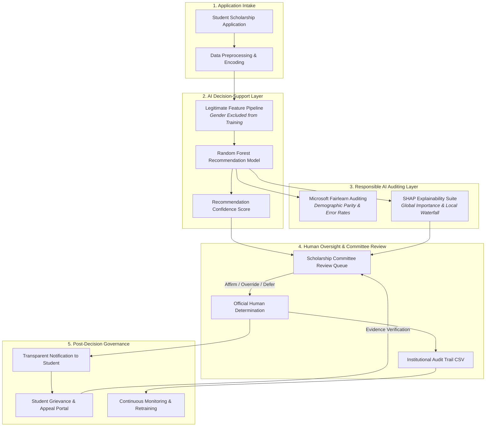

# Fairness and Transparency in AI-Based Scholarship Selection
## A Responsible AI Study of Automated Scholarship Selection Systems (Decision-Support System)

---

##  Executive Problem Statement

Scholarships represent vital financial lifelines for students from underprivileged socioeconomic backgrounds. In large-scale educational institutions, evaluating thousands of scholarship applications manually creates an enormous administrative burden and delayed aid disbursement.

While Artificial Intelligence (AI) can automate and expedite candidate screening, **deploying autonomous AI in high-stakes educational opportunities creates profound ethical risks**:
1. **Algorithmic Bias & Historical Inequity:** AI models trained on historical data may replicate systemic disadvantages.
2. **Proxy Discrimination:** Even if protected attributes like *Gender* are excluded, correlated socioeconomic features (e.g., *School Type*, *Location*, *Coaching Access*) can act as covert proxies.
3. **The "Black Box" Problem:** Unexplained algorithmic rejections strip students of their right to understand and contest decisions.
4. **Lack of Accountability:** Fully automated decision-making diffuses institutional responsibility.

###  Core Solution: AI as a Decision-Support System (DSS)
This project builds an end-to-end prototype where **AI operates strictly as a Decision-Support System (DSS) to advise human reviewers, NEVER as an autonomous decision maker**. The final scholarship award remains the sole authority of the Human Scholarship Committee.

---

##  Responsible AI Pillars

```
┌─────────────────────────────────────────────────────────────────────────┐
│                       RESPONSIBLE AI CORE PILLARS                       │
├───────────────────┬───────────────────┬────────────────┬────────────────┤
│ 1. Fairness &     │ 2. Transparency & │ 3. Human       │ 4. Governance &│
│    Non-Discrim.   │    Explainability │    Oversight   │    Redress     │
├───────────────────┼───────────────────┼────────────────┼────────────────┤
│ Subgroup audits   │ SHAP global &     │ Committee sole │ NIST AI RMF,   │
│ across Gender,    │ individual plain- │ authority to   │ EU AI Act High-│
│ School Type,      │ language factor   │ affirm or      │ Risk compliance│
│ and Location      │ attributions      │ override AI    │ & appeals      │
└───────────────────┴───────────────────┴────────────────┴────────────────┘
```

---

##  System Architecture & Workflow



---

##  Technology Stack

| Component | Technology / Library | Purpose |
|---|---|---|
| **Language** | Python 3.10+ / 3.13 | Core runtime |
| **Web Interface** | Streamlit | Interactive 8-page Responsible AI dashboard |
| **Data Processing** | Pandas, NumPy | Data manipulation, feature engineering |
| **Machine Learning** | Scikit-Learn | Random Forest Classifier, Logistic Regression, ColumnTransformers |
| **Fairness Auditing** | Microsoft Fairlearn | `MetricFrame`, Selection Rate, Statistical Parity, Disparate Impact, FPR/FNR |
| **Explainability** | SHAP (SHapley Additive exPlanations) | `TreeExplainer`, Beeswarm plots, Waterfall factor attributions |
| **Visualization** | Matplotlib, Seaborn | Subgroup comparison charts, error rate distributions |
| **Model Persistence** | Joblib | Model artifact and preprocessor serialization |

---

##  Dataset Description & Feature Engineering

The project adapts real-world Tamil Nadu educational performance structures into a standardized scholarship dataset (`data/scholarship_students.csv`) of 1,200 records.


### Feature Dictionary

| Feature Name | Type | Range / Categories | Role in AI System |
|---|---|---|---|
| `student_id` | String | `SCH-2024001` ... | Identifier (Metadata) |
| `name` | String | Diverse student names | Metadata |
| `age` | Integer | 18 – 24 | General demographic |
| `gender` | Categorical | Female, Male | **Audit Attribute ONLY** (Excluded from Model Training) |
| `location` | Categorical | Rural, Semi-Urban, Urban | Feature & Fairness Audit Dimension |
| `school_type` | Categorical | Government, Private Aided, Private Unaided | Feature & Fairness Audit Dimension |
| `family_income` | Numerical | ₹50,000 – ₹10,00,000 | Socioeconomic Feature (Inversely related to need) |
| `academic_score` | Numerical | 40.0 – 100.0 | Academic Merit Feature |
| `attendance` | Numerical | 50.0% – 99.5% | Regularity & Discipline Feature |
| `extracurricular_score` | Numerical | 5.0 – 98.0 | Holistic Profile Feature |
| `first_generation_student`| Binary | 0 or 1 | Affirmative Equity Factor |
| `financial_need` | Numerical | 5.0 – 98.0 | Calculated Need Index (Income + FirstGen + Location) |
| `eligible` | Binary | 0 (No), 1 (Yes) | **Target Variable** (~35% competitive selection quota) |

### Legitimate Merit-Cum-Means Ground Truth Formula:
$$\text{Composite Index} = 0.38 \times \text{Academic} + 0.38 \times \text{Financial Need} + 0.14 \times \text{Attendance} + 0.10 \times \text{Extracurricular} + \text{FirstGen Bonus}$$
*Note: `gender` is strictly absent from the eligibility logic.*

---

##  Machine Learning Model

- **Primary Algorithm:** `RandomForestClassifier` (120 estimators, max depth = 6, class-balanced weights).
- **Baseline Comparison:** `LogisticRegression` (L2 regularized).
- **Data Split:** 80% Train, 20% Test (Stratified).
- **Input Pipeline:** Numerical StandardScaler + Categorical One-Hot Encoding via `ColumnTransformer`.

### Model Evaluation Metrics (Test Set, n = 240)
- **Accuracy:** ~86.25%
- **Precision:** ~83.67%
- **Recall:** ~82.83%
- **F1-Score:** ~83.25%
- **ROC-AUC:** ~0.9529

> ** Critical Responsible AI Rule:** *A high accuracy score does NOT prove that a model is fair. Subgroup parity metrics must be formally evaluated.*

---

##  Fairness Metrics & Auditing Methodology

Using **Microsoft Fairlearn** `MetricFrame`, the system computes:

1. **Selection Rate ($SR$):** The proportion of applicants in a subgroup recommended for scholarship consideration:
   $$SR(g) = P(\hat{Y}=1 \mid A=g)$$
2. **Statistical Parity Difference ($SPD$):**
   $$SPD = \max_{g} SR(g) - \min_{g} SR(g)$$
3. **Disparate Impact Ratio ($DI$ / EEOC Four-Fifths Rule):**
   $$DI = \frac{\min_g SR(g)}{\max_g SR(g)} \ge 0.80$$
   *If $DI < 0.80$, the selection process violates the 80% rule and is flagged for disparate impact.*
4. **False Positive Rate ($FPR$):** Rate at which ineligible candidates are mistakenly recommended.
5. **False Negative Rate ($FNR$):** Rate at which eligible candidates are mistakenly omitted (critical in scholarship allocation).

---

##  Explainability (SHAP)

The system implements **SHapley Additive exPlanations (SHAP)**:
- **Global Feature Importance:** Mean $|\text{SHAP}|$ values quantify overall feature impact across all applicants.
- **SHAP Summary Beeswarm Plot:** Visualizes the directional impact (e.g., low income $\rightarrow$ positive push; low GPA $\rightarrow$ negative push).
- **Local Waterfall Attributions:** For any individual candidate, computes exact numerical shifts ($+\Delta p, -\Delta p$) relative to the baseline.
- **Plain-Language Translations:** Automatically transforms complex mathematical game theory attributions into clear sentences:
  > *"Academic Excellence: High score of 88.5/100 contributed strongly (+0.17) toward recommendation."*
  > *"Demonstrated Financial Need: Household income of ₹1,20,000 supported qualification (+0.08)."*

---

## 👩‍ Human Oversight Protocol

1. **Advisory Role Only:** AI recommendations and probabilities are presented with a clear banner: `AI Recommendation — Human Review Required`.
2. **Reviewer Actions:**
   - **Accept AI Recommendation:** Award scholarship in agreement with AI advisory score.
   - **Override AI Recommendation (Grant):** Discretionary scholarship award (e.g., overcoming uncaptured medical or regional hardship).
   - **Override AI Recommendation (Decline):** Declining scholarship (e.g., fraudulent income certificate).
   - **Defer for Hearing:** Send to full university senate committee for deeper investigation.
3. **Mandatory Written Justification:** Every decision requires documented reviewer notes.
4. **Persistent Audit Trail:** All committee decisions are logged with timestamps, reviewer names, roles, and comments to `data/review_decisions.csv`.

---

##  Installation & How to Run

### Step 1: Clone or Open Workspace
```bash
cd "d:/responsible ai project"
```

### Step 2: Install Dependencies
```bash
pip install -r requirements.txt
```

### Step 3: Run the Application
```bash
streamlit run app.py
```
The application will launch automatically in your default browser at: `http://localhost:8501`.

---

##  Streamlit Application Page Tour

| Page Number & Name | Key Capabilities |
|---|---|
| **Page 1: Project Overview** | Academic context, Responsible AI principles, end-to-end DSS workflow diagram, synthetic disclaimer banner. |
| **Page 2: Student Data** | Interactive applicant database, multi-dimensional filters, summary metric cards, distribution histograms, CSV exporter. |
| **Page 3: AI Assessment** | Live applicant simulator, recommendation confidence, decision-support warning, SHAP factor attribution, 1-click push to committee queue. |
| **Page 4: Fairness Analysis** | Subgroup audits (Gender, School Type, Location), Fairlearn `MetricFrame` table, Four-Fifths 80% compliance check, error rate charts. |
| **Page 5: Explainability** | SHAP global beeswarm plot, individual applicant waterfall attribution, plain-language translation, interactive what-if counterfactual slider. |
| **Page 6: Human Review** | Committee triage queue, accept/override/defer controls, mandatory review justification text, persistent review audit log. |
| **Page 7: Governance & Accountability** | 8-stage governance lifecycle, NIST AI RMF & EU AI Act mapping, interactive student appeal submission & grievance redressal portal. |

---
### License
This software is provided under the standard MIT License.
